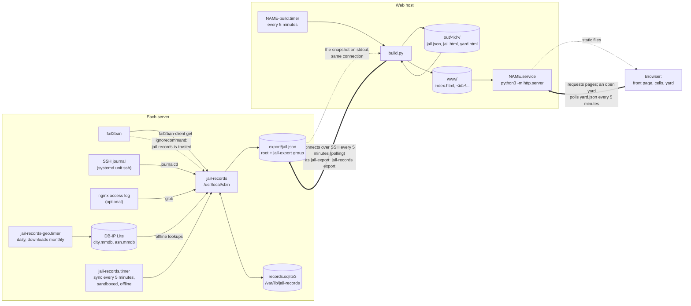
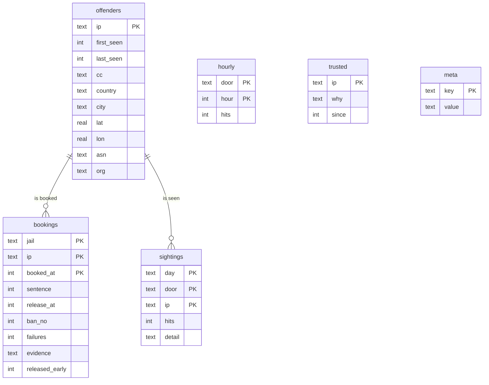
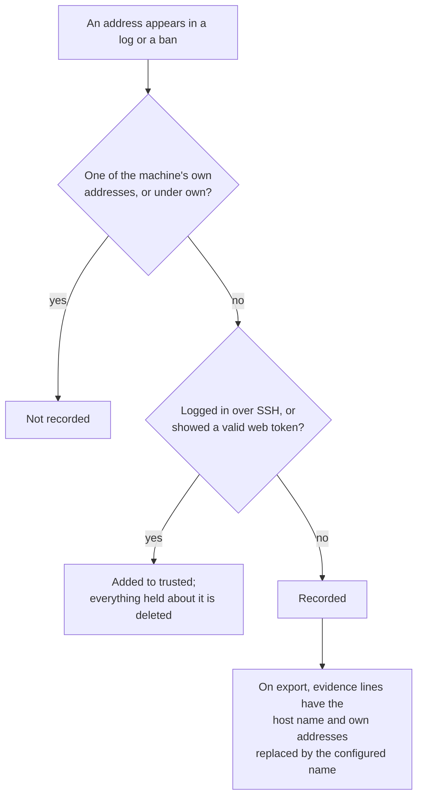
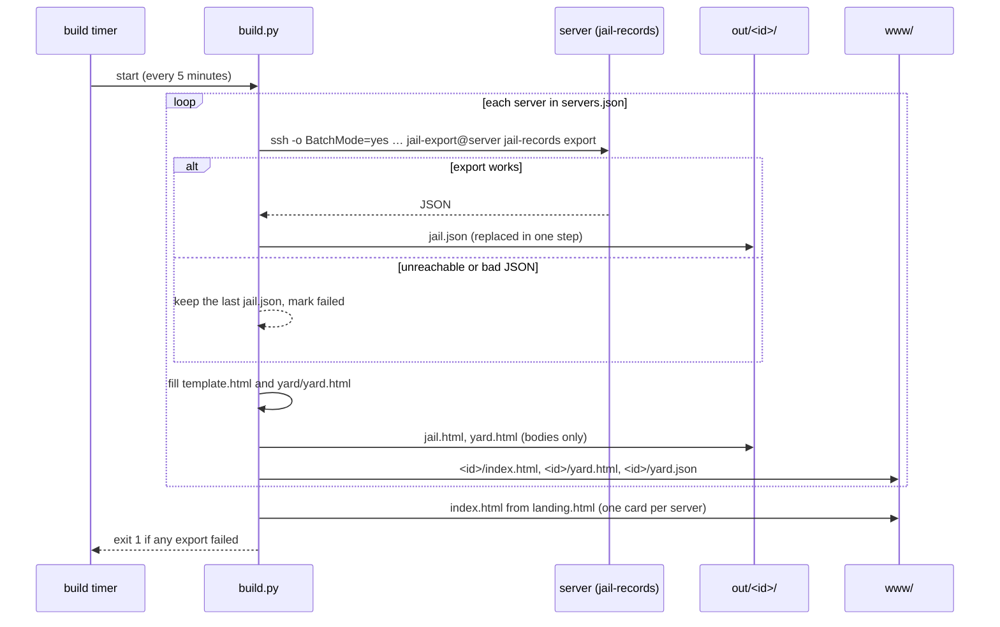
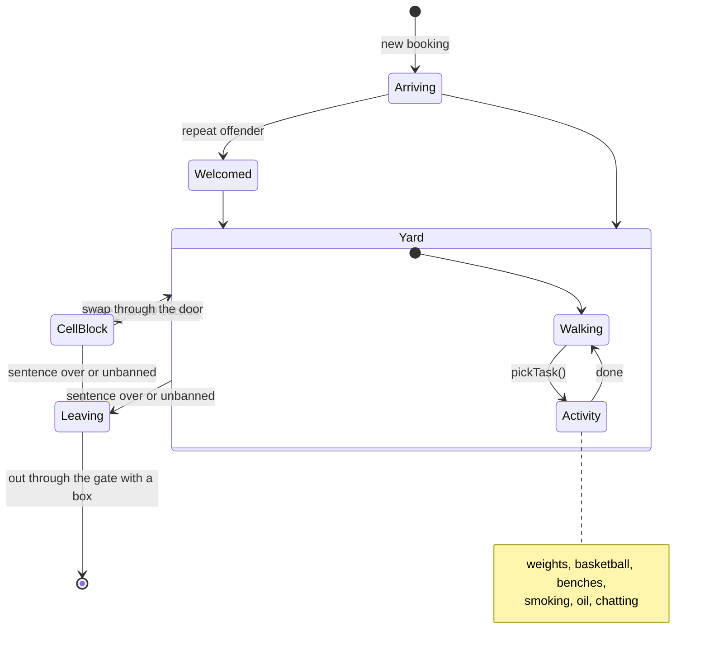
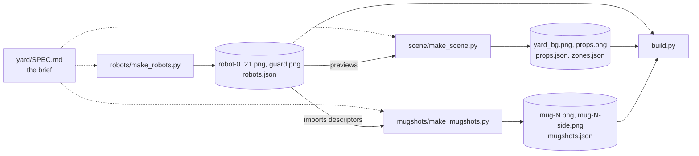
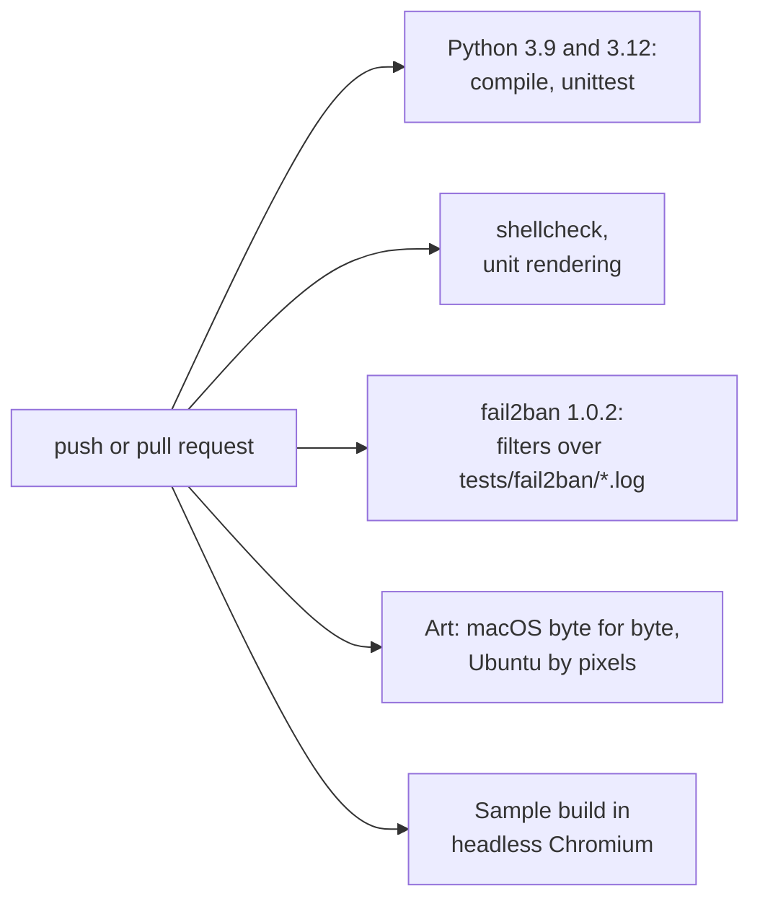

# Architecture

Botcatraz has three parts that never share a process:

1. **`server/jail-records`**, a single Python file on each server. It keeps a
   record of fail2ban's bans and of the knocks that led to them.
2. **`build.py`**, on a web host. It fetches each server's records over SSH and
   writes static pages.
3. **The pages**: the cells page (`template.html`), the yard (`yard/yard.html`)
   and the front page (`landing.html`). They run in the browser with everything
   inlined.

The pixel art in `yard/art/` is written by three generator scripts. It is
committed, and `build.py` inlines it into the pages.

## The whole system

Between the three places, a thick arrow points from the side that opens the
connection, and a dotted arrow shows what comes back over it. The web host
polls the servers and the browser polls the web host. A server never connects
to the web host and holds no key for it. Inside a box, arrows show which
way data moves.

Nothing calls out to the internet at run time, apart from two things: a server
downloads the DB-IP Lite databases once a month, and a browser loads the fonts
from Google Fonts.

## On each server: `jail-records`

| Command | What it does | Who runs it |
|---|---|---|
| `sync` | Reads fail2ban's live bans and settings, the SSH journal and the web logs for the last 7 whole days, and writes them into SQLite. Looks up new addresses in DB-IP. Then writes the export snapshot, one JSON document with everything the pages need. | `jail-records.timer`, every 5 minutes, as root in a sandbox |
| `export` | Prints the snapshot. Needs no root: the `jail-export` group may read it. | `build.py`, over SSH as `jail-export`, whose key can run nothing else |
| `is-trusted ADDR` | Exits 0 if the address is ours (own, already trusted, or logged in over SSH in the last day). Reads only; any error means "not trusted". | fail2ban, as its `ignorecommand` |
| `geo-update [--force]` | Downloads DB-IP Lite when the copy is older than 35 days, or always with `--force`. | `jail-records-geo.timer`, daily; `install.sh` |
| `stats` | Prints counts and the last sync time. | You |

`server/install.sh` installs the tool, `/etc/jail-records.json` (from
`site.json`), the two timers, and `python3-maxminddb`. With `export-key.pub`
next to it, it creates the `jail-export` account and locks that key to
`jail-records export` in `authorized_keys`
(`command="/usr/local/sbin/jail-records export",restrict`). It runs a first
`geo-update` and `sync`.

### Who may do what

| Part | Runs as | Can |
|---|---|---|
| `jail-records.service` (sync) | root, sandboxed | Read fail2ban, the journal and logs; write only `/var/lib/jail-records`. No IP network, no new privileges; of root's capabilities only `CAP_DAC_READ_SEARCH` |
| `jail-records-geo.service` | root, sandboxed | Reach the internet; write only `/var/lib/jail-records`; no capabilities at all |
| `jail-records export` | `jail-export` | Read the snapshot. Its SSH key runs only this command: no shell, terminal, forwarding or sftp |
| `jail-records is-trusted` | root, from fail2ban | Read only; any error means "not trusted" |

### What it keeps

A "door" is `ssh` or `web`. Each jail in the settings names its door, the letter
of its wing (used in booking numbers such as `S-4589`) and a label.

### What never leaves the server

## On the web host: `build.py`

Every file is written to a `.tmp` name and renamed, so the web server never
serves half a page. One server failing leaves its last good pages up.

### How a page is filled

The templates hold placeholders that `build.py` replaces with JSON.
`dumps()` escapes `</` so the data cannot close the `<script>` it sits in.

| Placeholder | In | Replaced with |
|---|---|---|
| `{{NAME}}` | `template.html`, `yard/yard.html` | The server's name from its own settings |
| `/*__DATA__*/null` | `template.html` | The whole export |
| `/*__LAND__*/null` | `template.html` | `land-110m.json`, the world outline |
| `/*__MUGS__*/null` | `template.html` | Booking photos as data URIs, from `yard/art/mugshots/` |
| `/*__YARD__*/null` | `yard/yard.html` | Who is inside, and who left in the last day (`yard_data()`) |
| `/*__ART__*/null` | `yard/yard.html` | Robot sheets, guard, background, props and zones, from `yard/art/` |
| `/*__LIVE__*/false` | `yard/yard.html` | `true` in the website copy, so it re-reads `yard.json` |
| `<!--NAV-->` | `template.html` | Links to the yard and the front page, in the website copy |
| `/*__SITES__*/null` | `landing.html` | One summary per server |

`--sample` skips SSH. It writes invented exports from `sample/make_sample.py`,
with addresses from the documentation ranges only.

`webhost/install.sh` turns the three `*.in` files into systemd units (a static
server, a build service and its timer) and remembers its options in
`install.conf`. `deploy-web.sh` copies the builder to a host and runs it there.

## In the browser

### The cells page

`template.html` draws everything from the inlined export: a cell per prisoner
with its booking photo, the rap sheet, a world map drawn from `land-110m.json`,
the busiest countries and networks, knocks per hour and recent releases. A link
ending in a booking number opens that cell.

### The yard

`yard/yard.html` is one canvas and no libraries. A robot's type is
`hash(ip) % types`, and the cells page picks the booking photo the same way, so
the two pages show the same robot.

| Loop | Rate | Does |
|---|---|---|
| `tick()` | every animation frame | `update(dt)` moves robots along `findPath()` routes on a grid built from `zones.json`, then `draw()` |
| `everySecond()` | 1 s | Releases robots whose time is up, starts queued events, swaps robots with the cell block (`balance()`) |
| `sync()` | 5 min, live copy only | Fetches `yard.json`: a new booking is an arrival, a missing one a release |

`?fast=N` speeds time up.

All three pages have a Lights out / Day shift button. The choice is kept in
`localStorage` under `lights`, shared by every page of the site: a small script
at the top of each page applies it before anything is drawn, and a `storage`
event switches pages that are already open.

## The art

The generators use Pillow and nothing else, and are deterministic. Each checks
its own output before it finishes: palette, anchors, frame counts, and for the
scene, the background's pixels against the accepted reference it embeds. The
number of robot types is set by the files: `build.py` globs `robot-*.png`, and
both pages take the count from the arrays they are given.

## Checks

The commands are in the README's "Checks" section and in
`.github/workflows/ci.yml`.

## Files

| Path | Role |
|---|---|
| `server/jail-records` | The server tool |
| `server/install.sh`, `jail-records.service`, `.timer`, `jail-records-geo.*` | Install it on a server, with its sandboxed units |
| `deploy.sh` | Copy `server/` to a server and install it |
| `build.py` | Fetch exports and write the pages |
| `template.html`, `yard/yard.html`, `landing.html` | The three pages |
| `land-110m.json` | World outline for the map |
| `webhost/` | Units and installer for the web host |
| `deploy-web.sh` | Copy the builder to a web host and install it |
| `sample/make_sample.py` | Invented records for `--sample` |
| `yard/art/` | Generators and their committed output |
| `docs/ART.md`, `docs/make_art_page.py`, `docs/art/` | A page of all the art, the script that draws its pictures, and the guide to making art |
| `docs/take_screenshots.js` | Takes the README screenshots with dates and half of each address blanked |
| `fail2ban/` | Optional filters and jails |
| `tests/` | Unit tests and check scripts |
