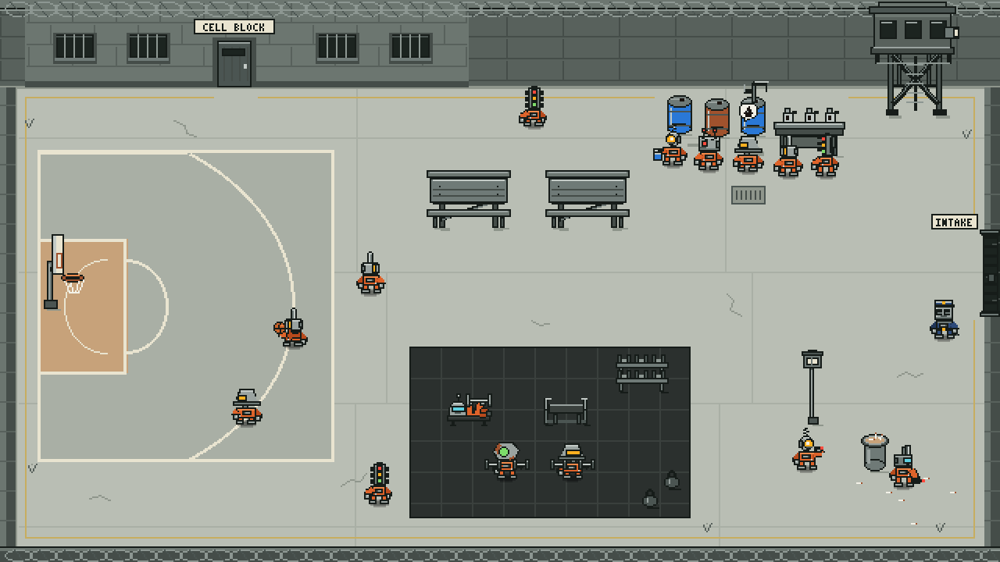
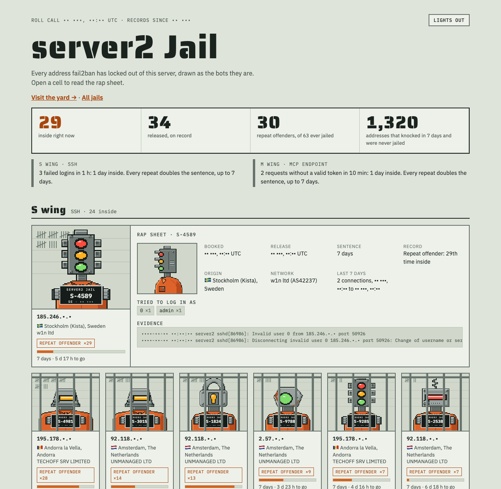
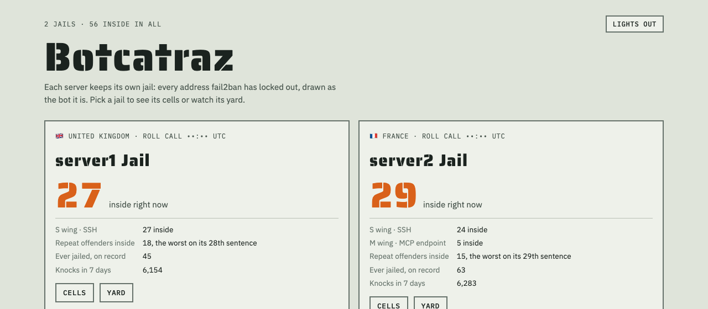

# Botcatraz

[](https://github.com/pgodlews/botcatraz/actions/workflows/ci.yml)

Your servers' fail2ban bans, drawn as a prison for bots.



**[Live demo](https://pgodlews.github.io/botcatraz/)**: built every hour from invented
records, so it changes like a real server would.

Every address fail2ban locks out becomes a pixel-art robot in an orange jumpsuit.
There are three pages:

- **Cells**: one cell per banned address, with a booking photo, where it came
  from, how long it has left and a rap sheet (what it tried, the log lines that
  got it banned). Below the cells: a world map, the busiest countries and
  networks, knocks per hour, and the ones that got away.
- **The yard**: the same prisoners as an animated exercise yard. They walk, lift
  weights, play basketball, sit, smoke and drink oil. A new ban walks in through
  the gate, a finished sentence walks out with a box, and a repeat offender is
  met by a welcoming party.
- **Front page**: one card per server, when you watch more than one.





The screenshots are from a real server. Dates and times are blanked out, and so
is the second half of every address. [`docs/take_screenshots.js`](docs/take_screenshots.js)
takes them that way.

## Try it without a server

You need Python 3.9 or later and nothing else.

```bash
./build.py --sample
```

```bash
python3 -m http.server 8850 --bind 127.0.0.1 --directory www
```

Then open <http://127.0.0.1:8850/>. The records are invented by
[`sample/make_sample.py`](sample/make_sample.py). The [live demo](https://pgodlews.github.io/botcatraz/) is
this same build, published by [`.github/workflows/demo.yml`](.github/workflows/demo.yml). Run the build again a while
later and an open yard picks up the new arrivals and releases within five
minutes. "Replay last arrival" shows an arrival straight away, and `?fast=6` on
the yard's address speeds time up.

## How it works

```
 each server                                         the web host (any machine, or a server itself)
 ┌─────────────────────────────────┐                 ┌──────────────────────────────────────────┐
 │ fail2ban ─┐                     │  SSH, polling   │ build.py, every 5 minutes:               │
 │ SSH log ──┼─> jail-records <────┼─────────────────┤   ssh SERVER jail-records export         │
 │ web log ──┘   (SQLite, 5 min) ──┼────────────────>│   fills template.html, yard/yard.html,   │
 │                                 │  JSON back      │   landing.html  ──>  www/  ──>  browser  │
 └─────────────────────────────────┘                 └──────────────────────────────────────────┘
```

The web host starts every connection. It polls each server over SSH, and the
JSON comes back on the same connection. A server never connects to the web
host and holds no key for it. Its only outgoing connection is the monthly
download of the geo databases.

fail2ban remembers only the latest ban per address, and the SSH journal and the
web log rotate away. `jail-records` is a single Python file that runs on each
server. Every 5 minutes it copies what matters into SQLite, adds the country,
city and network of each address, and writes a snapshot of everything the pages
need.

Lookups are offline. The server keeps a local copy of the
[DB-IP Lite](https://db-ip.com/db/lite.php) databases (free, refreshed monthly,
about 135 MB). No address is sent to any service, and nothing is ever sent to
the scanners themselves.

`build.py` asks each server for `jail-records export` over SSH, which prints
that snapshot, and fills three templates with the JSON it gets back. The pages
are static files with everything inlined (data, art, the world outline), apart
from the fonts.

### How the server side is locked down

- The sync runs as root, because only root may ask fail2ban for its bans. It
  runs in a systemd sandbox: it can write only its own records, has no internet
  access, and keeps one of root's powers, reading any file.
- The monthly download of the geo databases is a separate unit, the only part
  that goes online. It has no root powers at all.
- The web host logs in as `jail-export`, an account that can read the snapshot
  and nothing else of the records. Its SSH key is locked to the one command: no
  shell, no forwarding, no terminal. Whatever the web host asks to run, the
  server runs `jail-records export`. So someone who takes over the web host can
  read the snapshot and do nothing else on your servers.

## Install on a server

Requirements: Linux with systemd, fail2ban, Python 3 and SSH with sudo. It was
written on Ubuntu, and two things assume Debian or Ubuntu: the installer uses
`apt-get` for `python3-maxminddb`, and the SSH log is read from the systemd unit
named `ssh`.

1. Write a settings file for the server (see the next section), for example
   `server1.json`.
2. From your own machine:

   ```bash
   ./deploy.sh admin@server1.example.com server1.json --export-key jail_export.pub
   ```

   This copies `server/` to the server and runs `server/install.sh` there as
   root. It is safe to re-run. `--export-key` is the public half of the web
   host's SSH key (see [Build and host the pages](#build-and-host-the-pages)):
   it creates the `jail-export` account with that key. Leave it out on a later
   run and the account keeps its key. To install by hand, copy `server/` over,
   put your settings in it as `site.json` and the key as `export-key.pub`, and
   run `sudo bash install.sh` in it.

3. Check it:

   ```bash
   ssh admin@server1.example.com sudo jail-records stats
   ```

| Path on the server | Purpose |
|---|---|
| `/usr/local/sbin/jail-records` | The tool: `sync`, `export`, `geo-update`, `stats`, `is-trusted` |
| `/etc/jail-records.json` | Settings |
| `/var/lib/jail-records/records.sqlite3` | The records, readable by root only |
| `/var/lib/jail-records/export/jail.json` | The snapshot `export` prints, readable by root and the `jail-export` group |
| `/var/lib/jail-records/geo/city.mmdb`, `asn.mmdb` | DB-IP Lite, refreshed when older than 35 days |
| `jail-records.timer` | Runs `jail-records sync` every 5 minutes, in a sandbox without network access |
| `jail-records-geo.timer` | Runs `jail-records geo-update` daily; it downloads only when the copy is over 35 days old |
| `jail-export` | The account the web host logs in as, with its key in `/var/lib/jail-export/.ssh/authorized_keys` |

If sshd on the server has `AllowUsers` or `AllowGroups`, add `jail-export` to
it. The installer warns when it finds either.

### The settings file

`/etc/jail-records.json` is optional. Without it the server is called "server"
and only the `sshd` jail is recorded. Example:
[`server/jail-records.example.json`](server/jail-records.example.json).

| Key | Meaning |
|---|---|
| `name` | What the pages call this server. The real host name and addresses never appear in an export: in log lines they are replaced by this name. |
| `jails` | The fail2ban jails to record. For each: `door` (`ssh` or `web`), `wing` (the letter on booking numbers, such as `S-4589`) and `label`. |
| `web_logs` | A glob of nginx access logs for the `web` door. Optional; see [`fail2ban/README.md`](fail2ban/README.md) for the log format it reads. |
| `own` | Addresses of yours that must never be recorded, beyond the machine's own. |
| `address` | The server's public address, used only to place it on the map. Found from the routing table if left out, which finds only a private address behind NAT, as on most cloud servers: set it there. |

Never recorded: the machine's own addresses, the ones under `own`, any address
that has logged in over SSH, and any address that showed a valid web token.
The tool deletes what it holds about an address the moment it becomes trusted.

### What is kept

| Table | One row per | Holds |
|---|---|---|
| `offenders` | address | first and last seen, country, city, coordinates, network |
| `bookings` | ban | jail, when, sentence, release, which offence it was, the log lines that triggered it |
| `sightings` | address, day and door | how many connections or requests, usernames tried or paths asked for, user agents |
| `hourly` | door and hour | number of knocks |
| `trusted` | address | addresses that logged in over SSH or showed a valid web token |

## Build and host the pages

The builder needs Python 3 and an SSH key that the servers' `jail-export`
accounts accept. Make one on the web host, as the user that will run the
builder, with no passphrase so the timer can use it:

```bash
ssh-keygen -t ed25519 -N "" -C jail-pages -f ~/.ssh/jail_export
```

Copy `~/.ssh/jail_export.pub` to your own machine and give it to each server
with `./deploy.sh … --export-key jail_export.pub`. On the server it becomes
this line, which is what locks the key to one command:

```
command="/usr/local/sbin/jail-records export",restrict ssh-ed25519 AAAA… jail-pages
```

An earlier version had the web host run `sudo jail-records export`. If you set
up a sudoers rule for that, remove it: the installer points it out.

List your servers in `servers.json` (copy
[`servers.example.json`](servers.example.json)). `id` names the folder the
pages go in, `ssh` is what you would type after `ssh`, and `key` is optional:

```json
[
  {"id": "server1", "ssh": "jail-export@server1.example.com", "key": "~/.ssh/jail_export"},
  {"id": "server2", "ssh": "jail-export@203.0.113.20", "key": "~/.ssh/jail_export"}
]
```

Build once, by hand:

```bash
./build.py --www www
```

| Option | Effect |
|---|---|
| `--www DIR` | Lay out a website in `DIR`: `index.html`, and per server `<id>/index.html` (cells), `<id>/yard.html` and `<id>/yard.json` |
| `--no-export` | Rebuild from the last exports, for example after editing a template |
| `--only ID` | One server only |
| `--servers FILE` | A server list other than `servers.json` |
| `--sample` | Build from invented records instead of servers |

If one server cannot be reached, its last good pages stay up and the others are
still rebuilt. The fetched exports are kept in `out/`, together with
`out/<id>/jail.html` and `out/<id>/yard.html`: the same pages as bodies with no
document around them, for embedding in another page.

### Keep them current on a web host

```bash
./deploy-web.sh webhost.example.com
```

This copies the builder to `~/jail-pages` on that machine, installs three
systemd units, builds the pages every 5 minutes and serves them with Python's
built-in static file server.

| Option | Default | Meaning |
|---|---|---|
| `--dir DIR` | `jail-pages` | Where it lives on the web host, relative to the login's home directory or absolute |
| `--servers FILE` | `servers.json` | Installed on the web host as its `servers.json` |
| `--unit NAME` | `jail-pages` | Base name of the units: `NAME.service`, `NAME-build.service`, `NAME-build.timer` |
| `--user USER` | owner of the directory | The account that fetches, builds and serves. Its SSH key must reach the servers. |
| `--port N` | `8850` | Port the pages are served on |
| `--bind ADDR` | `127.0.0.1` | Address to listen on. `0.0.0.0` serves the whole network. |
| `--every MIN` | `5` | Minutes between rebuilds |

Your choices are remembered in `install.conf` on the web host, so a later
`./deploy-web.sh webhost.example.com` keeps them.
`bash webhost/install.sh --print` shows the unit files without installing
anything.

**Think before you put the pages on the open internet.** They list the
addresses that were banned, where they are registered and the log lines that
got them banned. An IP address can be personal data. The pages ask search
engines not to index them, the service listens only on the machine itself
unless you say otherwise, and the simplest safe setup is a private network or a
VPN. If you publish them, put a web server with access control in front.

## The yard

Each robot is one banned address. Which of the 22 robot types it gets is
fixed by its address, and the cells page uses booking photos of the same types,
so the robot in a cell is the robot in the yard.

- At most 30 robots are in the yard. The rest wait in the cell block and swap
  with those outside through its door.
- A new ban walks in through the main gate. A repeat offender is met by a
  welcoming party, bigger the more often it has been inside.
- A finished sentence, or an early unban, walks out through the gate with a box.
- Hover or tap a robot for its address, origin and time left. A click opens its
  rap sheet on the cells page. A link ending in a booking number, such as
  `#S-4589`, opens that cell.
- Lights out: the yard goes dark and the lamps and the tower's searchlight come
  on. Every page has the same button, and one press switches them all, open
  tabs included. They follow the system theme until you press it; the browser
  then remembers your choice.

A yard served next to its `yard.json` re-reads it every 5 minutes and compares
it with what it has: a new booking is an arrival, a missing one a release.
Releases also happen on time without the feed.

## Optional: fail2ban recipes

[`fail2ban/`](fail2ban/README.md) has two jails the pages were first built
around: a filter that counts password guesses against key-only SSH (which the
stock filter lets pass), and a jail for a token-protected web site.

## The art

The engine is [`yard/yard.html`](yard/yard.html): one canvas, no libraries. The
pixel art is in `yard/art/`. [`docs/ART.md`](docs/ART.md) shows all of it, with
every animation, and explains how to change it or add a robot type.

| Folder | What | Made by |
|---|---|---|
| `robots/` | 22 robot types and a guard, as sprite sheets of 32 x 32 frames, with `robots.json` describing the rows | `make_robots.py` |
| `scene/` | The 640 x 360 background, a props atlas, and `zones.json`, which tells the engine where the door, gate, court, benches and spots are | `make_scene.py` |
| `mugshots/` | Front and profile booking photos of the 22 types | `make_mugshots.py` |

The art was not drawn by hand. [`yard/SPEC.md`](yard/SPEC.md) is the brief.
OpenAI's Codex wrote the three generator scripts from it, and Google's
Antigravity later added six robot types to them. The scripts are deterministic:
with Pillow 11.3.0 on macOS, where the committed art was made, the same script
always writes the same bytes. Each one checks its own output (palette, anchors,
frame counts) before it finishes. On Linux zlib compresses the PNGs differently:
the files differ in their bytes, but not in their pixels.

To change the art, edit a generator and run it. They need
[Pillow](https://python-pillow.org) and nothing else:

```bash
python3 yard/art/robots/make_robots.py
```

```bash
python3 yard/art/scene/make_scene.py
```

```bash
python3 yard/art/mugshots/make_mugshots.py
```

Run them in that order: the scene's preview and the mug shots read the robots.
Each also writes previews, a report and a check transcript next to its images;
those are ignored by git. Then run `python3 docs/make_art_page.py` to refresh the
pictures in `docs/ART.md`, and rebuild the pages.

## Checks

GitHub Actions runs these on every push and pull request
([`.github/workflows/ci.yml`](.github/workflows/ci.yml)). Each one also runs on
your own machine:

| Check | Command | Needs |
|---|---|---|
| Sample build, web log parser, art metadata | `python3 -m unittest discover -s tests` | Python 3.9 or newer; Node.js to also syntax-check the page scripts |
| Shell scripts | `shellcheck ./*.sh server/install.sh webhost/install.sh tests/*.sh` | ShellCheck |
| fail2ban filters against the logs in `tests/fail2ban/` | `tests/check_fail2ban.sh` | fail2ban (tested with 1.0.2) |
| The generators reproduce the committed art and `docs/art/` | `tests/check_art.sh` on macOS, byte for byte; `tests/check_art.sh --pixels` elsewhere | Pillow 11.3.0 |
| The three pages in a browser, including the replay | `./build.py --sample && node tests/check_pages.js` | Node.js and Playwright |

In the fail2ban test logs, a line that must count as a failure comes from
203.0.113.0/24 or 2001:db8::/32, and every other line must not count.

## Removing it

On a server:

```bash
sudo systemctl disable --now jail-records.timer jail-records-geo.timer
```

```bash
sudo rm -rf /etc/systemd/system/jail-records.service /etc/systemd/system/jail-records.timer /etc/systemd/system/jail-records-geo.service /etc/systemd/system/jail-records-geo.timer /usr/local/sbin/jail-records /etc/jail-records.json /var/lib/jail-records /var/lib/jail-export && sudo systemctl daemon-reload
```

```bash
if getent passwd jail-export >/dev/null; then sudo userdel jail-export; fi; if getent group jail-export >/dev/null; then sudo groupdel jail-export; fi
```

On the web host, in the install directory:

```bash
sudo bash webhost/install.sh --remove
```

Then delete the directory.

## Credits and licences

The code and the art in this repository are under the [MIT licence](LICENSE),
copyright Piotr Godlewski. That covers the server tool, the builder, the
templates, the yard engine, the generator scripts and the images they write.
The material below belongs to others and keeps its own terms.

- **Countries, cities and networks**: [IP Geolocation by DB-IP](https://db-ip.com).
  The DB-IP Lite databases are licensed under
  [CC BY 4.0](https://creativecommons.org/licenses/by/4.0/). They are not in
  this repository: each server downloads its own copy. The licence asks for a
  link back to DB-IP on pages that show its results, which is why the page
  footers carry one. Keep it if you change the templates.
- **World outline**: `land-110m.json` is from the
  [world-atlas](https://github.com/topojson/world-atlas) package by Mike Bostock
  (ISC licence), which is built from [Natural Earth](https://www.naturalearthdata.com)
  1:110m land data (public domain). The notice is in
  [`THIRD-PARTY.md`](THIRD-PARTY.md).
- **Fonts**: IBM Plex Sans, IBM Plex Mono and Saira Stencil One, all under the
  SIL Open Font License 1.1. They are not in this repository: the pages load
  them from Google Fonts, so a visitor's browser contacts Google. Remove the
  `<link>` at the top of each template to fall back to system fonts.
- **Art**: generated by the scripts in `yard/art/`, which OpenAI's Codex wrote
  from `yard/SPEC.md` and Google's Antigravity extended.
- **fail2ban** is a separate project and is not included.
