# The art

Every image in Botcatraz is pixel art written by three Python scripts in
[`yard/art/`](../yard/art). Nothing is drawn by hand. This page shows all of it,
and the second half explains how to change it.

The pictures on this page are made from the committed art by
[`make_art_page.py`](make_art_page.py), scaled up without smoothing.

## The robots

The 22 inmate types and the guard, walking towards you. They are in order,
left to right: type 0 is top left and the guard is last.

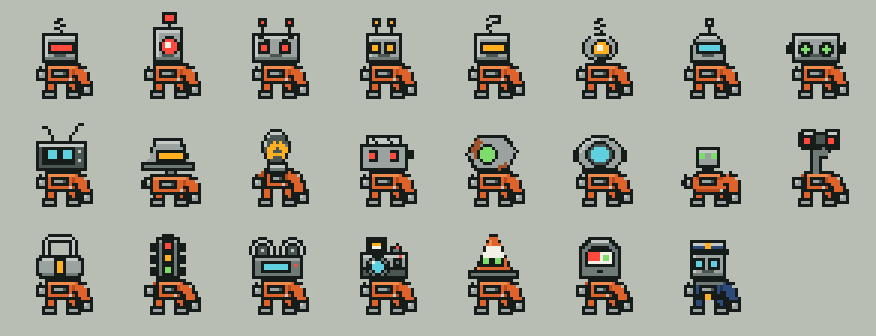

## Every animation

Type 0 playing all 17 rows of its sheet, each at its own speed: idle (facing
you, sideways, away), walk (the same three ways), sit, bench press, curls,
dribble, jump shot, smoke, drink oil, wave, fist bump, talk, and sitting with
its back to you. The engine mirrors the sideways rows for walking left.

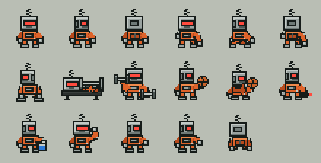

The guard has only seven rows: idle and walk in three directions, and a wave.

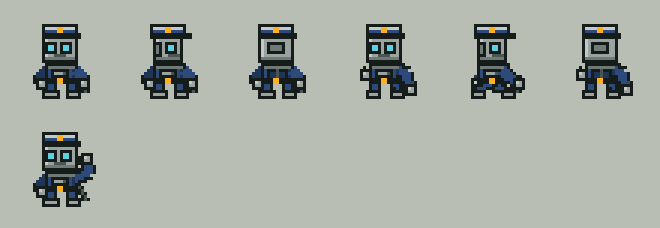

## The sprite sheets

These are the files the yard reads: one sheet per type, then the guard. Each
is 6 frames across and 17 rows down, 32 x 32 pixels per frame, shown here at
2x.

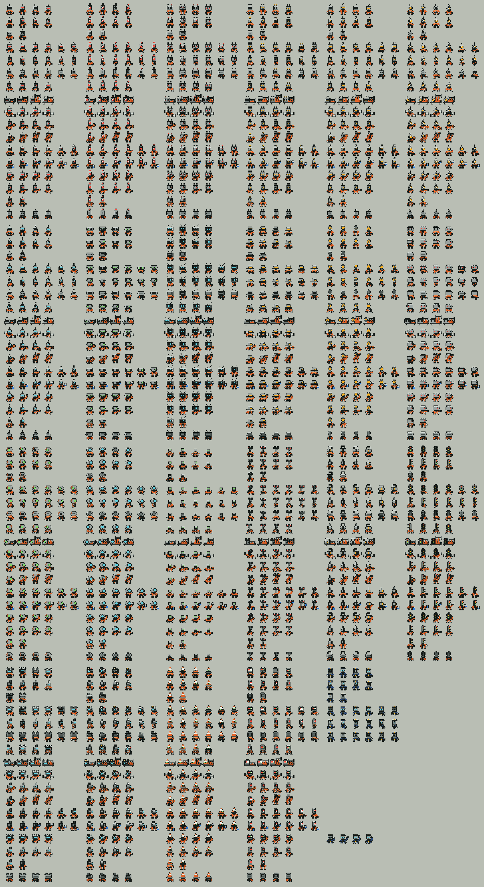

## Booking photos

The cells page shows a front photo and a profile for each type. They are drawn
at 100 x 85 pixels, shown here at 2x. The page writes the booking number on the
blank placard.

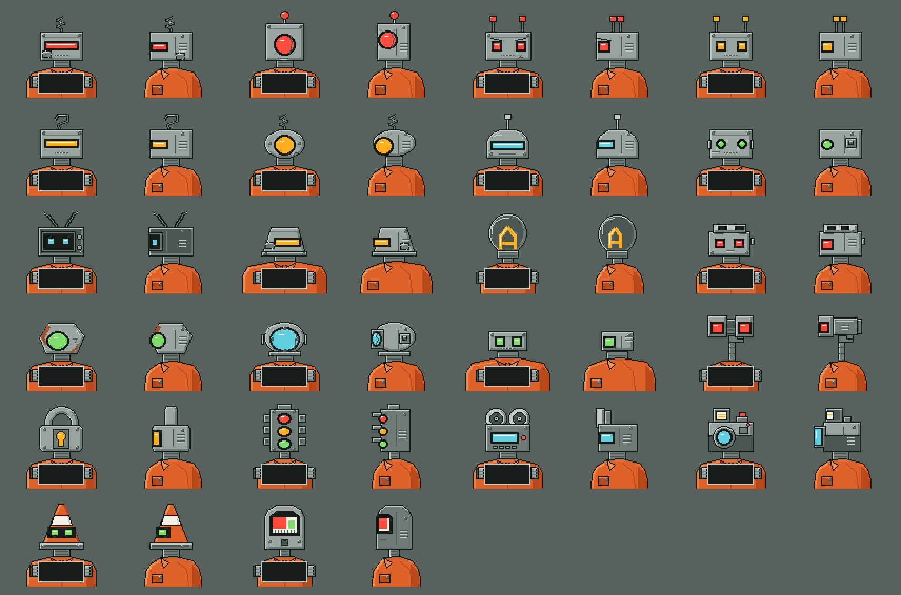

## The yard

The 640 x 360 background with every fixed prop in place and the doors closed,
at 2x. The engine draws robots between the props, sorted by where their feet
are.

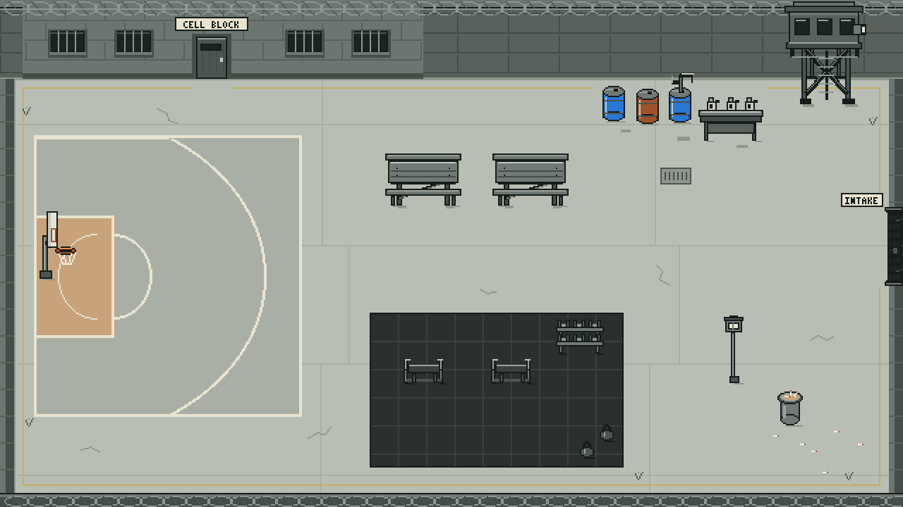

The props atlas, at 4x on a checker. It holds the props drawn above,
the animation frames of the gate and the cell block door, and the small pieces
the engine moves around: the ball, smoke puffs, the speech bubbles and the box a
released robot carries.

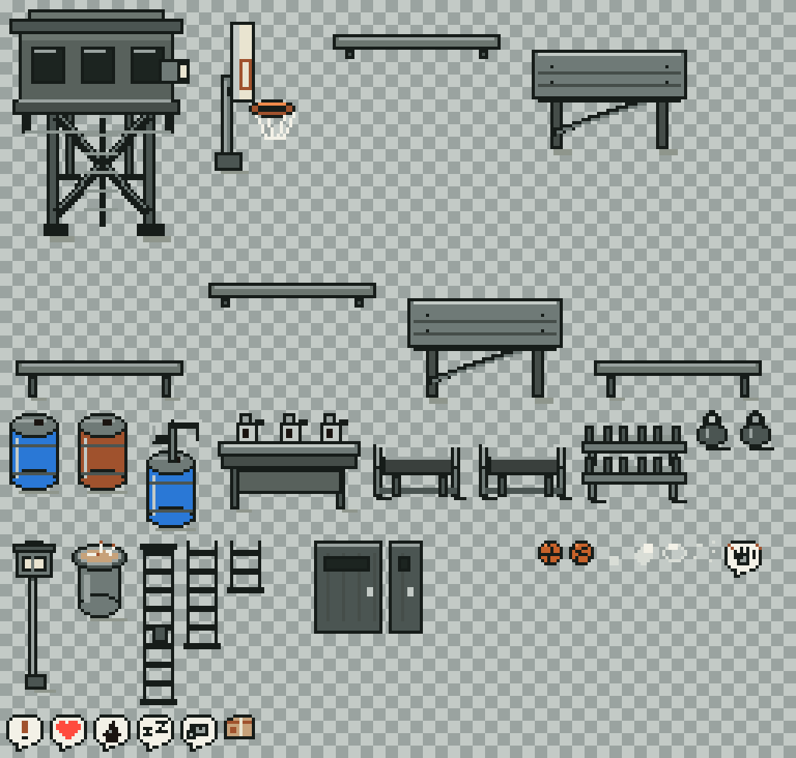

## The types

<!-- types -->
| # | Head | Antenna | Eyes | Booking photos |
|---|---|---|---|---|
| 0 | box | coil spring | red visor slit | 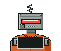 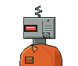 |
| 1 | tall box | single rod, red ball tip | one big round red lens | 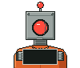 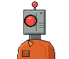 |
| 2 | wide box | twin rods, red tips | two red square eyes, angry brow line | 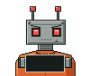 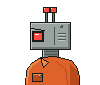 |
| 3 | box | twin rods, amber tips | two amber square eyes |  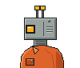 |
| 4 | box | curly wire | amber visor bar | 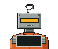 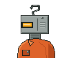 |
| 5 | round | coil spring | one big amber lens | 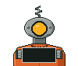 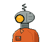 |
| 6 | dome | single rod | cyan visor |  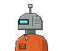 |
| 7 | wide box with ear bolts | none | two green round eyes | 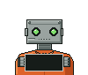 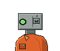 |
| 8 | television | rabbit ears | two cyan screen eyes | 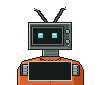 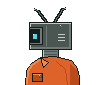 |
| 9 | upturned bucket, stocky | none | one amber slot eye | 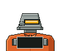 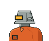 |
| 10 | glass bulb, slim tall | none | glowing amber filament | 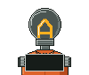 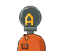 |
| 11 | toaster, two top slots | none | two red LED eyes | 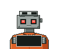 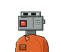 |
| 12 | hexagonal nut, rust accents | none | one off-centre green lens | 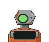 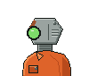 |
| 13 | diving helmet | none | round cyan porthole | 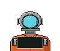 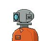 |
| 14 | small head, barrel body, stocky | none | two green eyes | 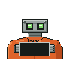 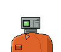 |
| 15 | binocular head, periscope neck, slim | none | two red eyes | 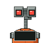 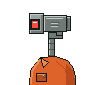 |
| 16 | padlock with U-shackle | none | amber keyhole |  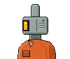 |
| 17 | traffic signal, slim | none | red, amber and green lenses | 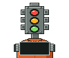 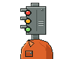 |
| 18 | reel-to-reel tape deck | none | cyan tape window | 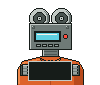 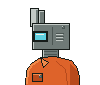 |
| 19 | flash camera | none | cyan lens barrel | 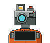 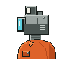 |
| 20 | safety cone, white band | none | two green eyes | 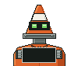 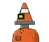 |
| 21 | parking meter, slim | none | red expired flag window | 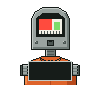 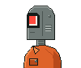 |
| guard | box with peaked cap | none | two cyan square eyes | none |
<!-- /types -->

A robot's type is its address's hash, modulo the number of types. The cells page
picks the booking photo the same way, so a prisoner looks the same on both pages.

# Making art

## How it fits together

[`yard/SPEC.md`](../yard/SPEC.md) is the original brief: the palette, the frame
size, the yard's layout and what each animation shows. It was written for the
first eight types; the scripts have grown since, and the JSON files they write
describe what is there now.

| Script | Writes | Reads |
|---|---|---|
| `yard/art/robots/make_robots.py` | `robot-0.png` … `robot-21.png`, `guard.png`, `robots.json` | nothing |
| `yard/art/scene/make_scene.py` | `yard_bg.png`, `props.png`, `props.json`, `zones.json` | the robot sheets, for one preview |
| `yard/art/mugshots/make_mugshots.py` | `mug-N.png`, `mug-N-side.png`, `mugshots.json` | `make_robots.py`, for the type list and palette |

Each script draws with Pillow, one pixel or rectangle at a time. There is no
randomness, so the same script always writes the same images. Each script also
writes, next to its images, files that git ignores:

- `preview/`: the art scaled up, for looking at. `robots/preview/index.html` is a
  page of every animation as a GIF.
- `REPORT.md`: what the script made and what it checked.
- `self-check.txt`: the output of its checks.

## The rules

These hold for all the art. The scripts check most of them and stop if one
breaks.

- **Pixel art only.** Hard edges, no anti-aliasing, no gradients, and alpha is
  either 0 or 255.
- **One palette.** At most 40 colours across all the art, taken from the list in
  `SPEC.md`. A new colour must be a close relative of one there, and the script
  must list it as an addition.
- **Robots.** Frames are 32 x 32. The centre of the feet is at pixel (16, 28) in
  every standing frame, because the engine puts that point on the ground. Robots
  have a 1 pixel outline in `#161c19`. Light comes from the top left. Robots
  have no baked-in shadow, because the engine draws one.
- **Types must be told apart** at 2x by head shape and eye colour alone.
  `make_robots.py` checks that no two types have the same outline.
- **No text** in any image, apart from the `CELL BLOCK` and `INTAKE` signs.
- **Booking photos** are 100 x 85 with a blank 44 x 20 placard, and must look
  like the same robot as in the yard.

## Change something

1. Edit the generator, for example the head of one type in `make_robots.py`.
2. Run the generators in order. The later ones read the robots.

   ```bash
   python3 yard/art/robots/make_robots.py
   ```

   ```bash
   python3 yard/art/scene/make_scene.py
   ```

   ```bash
   python3 yard/art/mugshots/make_mugshots.py
   ```

3. Look at the previews, not only at the checks. The checks catch broken rules;
   only your eyes catch a robot that looks wrong.
4. Rebuild this page's pictures and the sample site, and look at the yard:

   ```bash
   python3 docs/make_art_page.py
   ```

   ```bash
   ./build.py --sample
   ```

5. Commit the script and every file it rewrote, including `docs/art/`.

## Add a robot type

Most of the work is drawing one head five ways: facing you, sideways, from
behind, blinking and talking. The bodies, the animations and both pages pick
up a new type by themselves.

1. **In `make_robots.py`:**
   - Add a line to `VARIANTS` just before the guard: its file name, head,
     antenna, eyes and eye colour.
   - Raise `GUARD` by one. It is the guard's position in that list.
   - Draw the head in `extra_head()`, in a new `elif v == N:` branch. The
     neighbouring branches show how to handle `direction` (`viewer`, `right`,
     `away`), `blink`, `talking` and `antenna_dx`. The head sits in a 32 x 20
     space, and the neck joins it at (16, 17).
   - For a slim or stocky body, add the type to `build()`.
2. **In `make_mugshots.py`:**
   - Map the new head description to a kind in `KINDS`.
   - Draw that kind facing front in `head()` and in profile in `profile()`.
   - Raise the number in `assert N_TYPES == 22`.
3. Run the three generators and look at the previews: `robots/preview/lineup-3x.png`,
   `faces-8x.png` and `sheet-robot-N-4x.png`, and `mugshots/preview/match-6x.png`,
   which puts each photo beside its yard sprite.
4. Update the number of types in `README.md`, then run the checks below.

## Check it

```bash
tests/check_art.sh
```

This runs the three generators and fails if any file comes out different from
the committed one. Run it after committing, to show the art can be rebuilt. The
committed art was made with Pillow 11.3.0 on macOS. On Linux, use
`tests/check_art.sh --pixels`: there the PNG files come out with different bytes
but the same pixels.

```bash
python3 -m unittest discover -s tests
```

This checks that the sprite sheets, `robots.json` and `mugshots.json` agree on
the number of types, and that the sample build still works.
